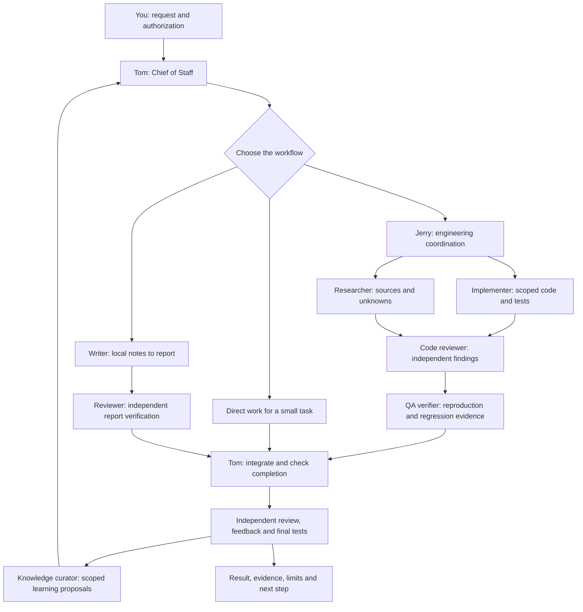
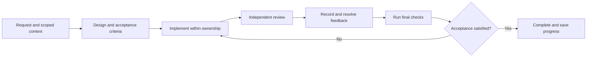

# Smart Assistant

Smart Assistant is a Codex-based assistant coordinated by **Tom**, the Chief of
Staff. Give Tom an ordinary request; Tom scopes the work, selects an appropriate
workflow, coordinates available specialists, checks the result, and saves progress
and scoped lessons for later work.

This repository contains the coordination rules, Python helpers, agent definitions,
skills, examples, tests and implementation evidence. The AI execution comes from
the signed-in Codex host. Running the Python CLI alone does not start an AI assistant.

## How Tom works with other agents



This diagram describes responsibilities, not agents all running simultaneously.
The expanded six-role core team, including **Jerry 2.0.0**, is **DRAFT**. The existing
engineering-lead **1.0.0** has a narrower verified managed scope. The inventory below
separates those versions. Host builtin workers may take explicit responsibilities
without loading or activating a DRAFT agent definition.

Tom owns the overall request, authorization checks, task state, integration and final
answer. Jerry coordinates bounded engineering work. Implementers own assigned files;
reviewers independently inspect the candidate; QA checks required cases and evidence.
At most **two specialists execute across the whole task tree**, including an active
lead. Missing tools, configured roles or required proof remain explicit blockers.

## The work cycle



For a defect, reproduce it first and preserve the unfixed result. Compare matching
before/after cases, run affected regression checks, then run the final developer
suite. A passing helper test is evidence at that level; it does not establish live
customer, UI, database, upstream or business acceptance.

For durable delivery, Tom uses `request-coordination` to register the request and
policy, record scoped assignments/dependencies, bind actual handoffs and evidence,
and check completion. Changed inputs or artifacts invalidate affected evidence.
Lessons retain provenance, scope and revalidation conditions. This is file-based
learning during authorized work; no model retraining or background service runs.

## Quick start

### 1. Check out and test the helpers

Requirements: **Git** and **Python 3.11 or later**. The Python helpers use the standard
library; their CLI and tests require no package installation or model API key.

```sh
git clone https://github.com/vtran20/smart-assistant-public.git
cd smart-assistant-public
python3 --version
python3 -m smart_assistant --help
python3 -m smart_assistant team show --profile examples/teams/core/team.json
python3 -m unittest discover -s tests -v
```

### 2. Open the project in Codex

Use a working, signed-in Codex client with shell access. Open this repository as the
project folder, review [AGENTS.md](AGENTS.md), grant the workspace access needed for
your request, and start a fresh chat to discover the project skills/configuration.
Use the current clone as your workspace; no owner-specific folder is required.

Example requests:

- “Tom, use these local notes to write a report, have it independently reviewed,
  and save progress.”
- “Tom, investigate this bug, reproduce it, implement the smallest fix, and return
  the reviewed result with before/after evidence.”
- “Resume this saved task from its recorded next step.”
- “Add a research agent, evaluate it, and keep it DRAFT until native proof passes.”

Repository workflows are [skills](https://learn.chatgpt.com/docs/build-skills).
[Subagent support](https://learn.chatgpt.com/docs/agent-configuration/subagents) and
[project configuration](https://learn.chatgpt.com/docs/config-file/config-basic)
depend on the installed Codex host. Verify actual discovery and callable tools;
configuration files alone are not proof that an agent ran.

### 3. Choose an execution mode that is actually available

| Mode | What must be available | Meaning |
| --- | --- | --- |
| Direct/bootstrap | Codex, scoped files/tools and authorization | Tom performs appropriate work; independent review is still required by this project. |
| Builtin workers | Actual host subagent tools, explicit recorded responsibilities and real context bindings | Workers execute bounded assignments. This does not activate the DRAFT team. |
| Managed capabilities | Current eligible catalog records, matching manifests, genuine native discovery/invocation proof and passing preflight | Invoke the exact verified capability/version within its accepted scope. |

**A fresh clone does not inherit the owner's activation state.** Private deployment
receipts under `.smart-assistant/` and immutable staging under `capabilities/staging/`
are intentionally ignored. The tracked catalog records six ACTIVE capabilities,
but those records alone cannot reproduce eligibility on another machine. Use the
management workflows to establish legitimate local proof; do not toggle catalog
states or invent receipts to bypass it.

## Supported agents

Status below distinguishes inspected owner-checkout eligibility from reusable source.
The [catalog](capabilities/catalog.json) and current eligibility check govern managed
dispatch. The [core profile](examples/teams/core/team.json) describes the DRAFT team.

| Agent / responsibility | Version | Status and purpose |
| --- | --- | --- |
| **Tom**, Chief of Staff | Bootstrap root | Main-chat coordinator; no artificial catalog self-entry. |
| [Writer](.codex/agents/writer.toml) | 2.0.0 | ACTIVE and eligible in the owner checkout: reports and source maps from supplied local notes. |
| [Reviewer](.codex/agents/reviewer.toml) | 2.0.0 | ACTIVE and eligible in the owner checkout: independent report/source-map verification. |
| [Engineering lead](.codex/agents/engineering-lead.toml) | 1.0.0 | ACTIVE and eligible in the owner checkout: bounded engineering coordination. |
| [Jerry / engineering-lead](examples/agents/engineering-lead/versions/2.0.0/engineering-lead.toml) | 2.0.0 | DRAFT: expanded technical lead for the core team. |
| [Implementer](examples/agents/implementer/versions/1.0.0/implementer.toml) | 1.0.0 | DRAFT: assigned source, configuration and test changes. |
| [Code reviewer](examples/agents/code-reviewer/versions/1.0.0/code-reviewer.toml) | 1.0.0 | DRAFT: independent engineering review. |
| [QA verifier](examples/agents/qa-verifier/versions/1.0.0/qa-verifier.toml) | 1.0.0 | DRAFT: reproduction, regression and requirement/case verification. |
| [Researcher](examples/agents/researcher/versions/1.0.0/researcher.toml) | 1.0.0 | DRAFT: bounded research with provenance and uncertainty. |
| [Knowledge curator](examples/agents/knowledge-curator/versions/1.0.0/knowledge-curator.toml) | 1.0.0 | DRAFT: scoped, sanitized lessons and maintenance proposals. |
| [Xstore triage](examples/agents/xstore-triage/versions/1.0.1/README.md) | 1.0.1 | DRAFT: Xstore evidence assessment; fresh native behavior evaluation remains open. |

Historical researcher v1/v2 and engineering-lead example files are lifecycle fixtures,
not additional ACTIVE identities. Agent definitions inherit the caller's model,
effort and permission boundaries; names do not grant account access or authority.

## Supported skills

All six project workflow skills live under [.agents/skills](.agents/skills).

| Skill | Category / status | What it does |
| --- | --- | --- |
| [request-coordination](.agents/skills/request-coordination/SKILL.md) | Bootstrap entry point | Intake, registration/resume, routing, preflight, durable delivery and completion checks. |
| [manage-agent](.agents/skills/manage-agent/SKILL.md) | Bootstrap entry point | Create, validate, stage, evaluate and manage agent lifecycle transactions. |
| [manage-skill](.agents/skills/manage-skill/SKILL.md) | Bootstrap entry point | Create, validate, stage, evaluate and manage workflow skill lifecycles. |
| [draft-document](.agents/skills/draft-document/SKILL.md) | 1.0.0; ACTIVE and eligible in the owner checkout | Source-grounded report: Summary, Decisions, Action items and Open questions. |
| [verify-completion](.agents/skills/verify-completion/SKILL.md) | 1.0.0; ACTIVE and eligible in the owner checkout | Independently check the report and source map against supplied notes and criteria. |
| [delegate-work](.agents/skills/delegate-work/SKILL.md) | 1.0.0; ACTIVE and eligible in the owner checkout | Bounded engineering delegation, owned files, handoffs and integration review. |
| [count-local-items](examples/skills/count-local-items) | Example only; v1/v2 | Demonstrates workflow lifecycle/version changes; not an ACTIVE production skill. |

Bootstrap entry points are discovered source skills, not extra ACTIVE catalog entries.
The example copy of `delegate-work` is the same workflow's source example.

Optional user-owned skills such as `coding-guideline`, Xstore evidence/setup/upgrade
skills, and host plugins for documents, spreadsheets or connected services are
separate installations. They are not bundled by this repository or automatically
available after cloning. Follow AGENTS.md's core fallback rules when a referenced
personal skill is unavailable. Only claim a host skill/tool when current discovery
and permission checks support it.

## Adapt it for your own work

Follow the [sharing and customization guide](docs/sharing.md). Keep your task
state and preferences in ignored `.smart-assistant/` storage. The shared rules
work without installing the owner's personal rules or connecting their accounts.

## What is needed for the complete assistant?

| Area | Available now | What remains or must be configured |
| --- | --- | --- |
| Local foundation | Task/context storage, catalog/lifecycle validation, preflight and completion helpers; JSON CLI and regression suite | Run the checks in the target environment. |
| Tom coordination | Repository bootstrap skills, saved delivery/evidence contracts, scoped learning | Use the actual discovered entry point; keep scoped state and next steps current. |
| Builtin delegation | Implemented helpers and an evidence-backed local seeded-bug demonstration | Host subagent tools and authentic per-task bindings/review/verification; other domains need their own acceptance. |
| Full configured Tom/Jerry team | Six DRAFT role definitions and a DRAFT team profile | Exact-source native discovery, invocation and behavior evaluation, independent review, then legitimate lifecycle activation. |
| Managed report/delegation workflows | Six eligible capabilities in the inspected owner checkout | Fresh clones need their own private staging/deployment/native proof and current preflight. |
| Xstore specialist | DRAFT 1.0.1 source and scoped evaluation assets | Fresh native behavior/discovery proof and project/version-specific evidence. |
| Outlook, Slack, Jira and other services | Interfaces/workflow boundaries and host-dependent connectors | Connect the required service, verify account access and authorize the concrete action. |
| Recurring work | Future capability scope in the backlog | A separately requested, supported scheduling integration and its acceptance; none starts from this clone. |
| Customer/runtime acceptance | Proof is recorded at its actual scope | Supply the authorized environment and complete its UI/database/upstream/business checks. |

There is no mandatory backend, daemon or model-training service. See the
[capability backlog](docs/capability-backlog.md) for product status; a completed
document, a configured file or a green unit suite does not complete every capability.

## Repository map and private state

| Path | Purpose | Commit? |
| --- | --- | --- |
| `smart_assistant/` | Standard-library Python implementation and CLI | Yes |
| `tests/` | Unit, negative, contract and integration tests | Yes |
| `.agents/skills/`, `.codex/` | Project skills and configured role sources | Yes, after review |
| `capabilities/catalog.json` | Managed capability metadata | Yes; not private activation proof |
| `examples/` | Role/team versions, scenarios and workflow fixtures | Yes; examples are not automatically ACTIVE |
| `docs/` | Architecture, workflows and reusable design contracts | Yes, after privacy review |
| `docs/evidence/` | Local execution history; two reusable interface contracts are retained | No, except retained contracts |
| `tests/fixtures/` | Reviewed synthetic regression inputs | Yes |
| `.smart-assistant/` | Private task/deployment state, profiles, portfolio and recovery records | No |
| `capabilities/staging/` | Private immutable lifecycle staging | No |
| `.worktrees/`, `work/`, `outputs/` | Isolated checkouts and local execution material | No |
| `.env*`, `.idea/`, caches and raw host stderr | Secrets, machine state or potentially sensitive logs | No |

Customer settings, raw captures and email-derived investigation belong in ignored
local/owning-project storage. A GitHub clone distributes reviewed project source,
not private portfolio, customer knowledge, active task records or credentials.
Use scoped pushes; do not push archived local histories merely to publish new source.

## Useful commands and further reading

```sh
# Inspect the DRAFT core team without activating it.
python3 -m smart_assistant team show --profile examples/teams/core/team.json

# Managed checks for an environment with its genuine local proof available.
python3 -m smart_assistant catalog validate --project-root .
python3 -m smart_assistant catalog eligible --project-root . --tools /path/to/observed-tools.json
python3 -m smart_assistant preflight --request /path/to/actual-preflight.json
```

`observed-tools.json` must be a regular JSON file of actually observed tool names.
These last commands can deny on a fresh clone with missing proof/tools; preserve that
result and establish the required setup rather than weakening checks.

- [Tom/Jerry delivery runbook](docs/tom-orchestration-workflow.md) and
  [runtime decision](docs/tasks/tom-orchestration/runtime-decision.md).
- Builtin execution evidence and limits (local historical archive: `docs/evidence/builtin-execution/acceptance.md`).
- [Local report workflow](docs/p07-report-workflow.md),
  [bounded delegation](docs/p08-delegation-workflow.md), and
  [integrated acceptance](docs/p09-integrated-acceptance.md).
- [Xstore triage workflow](docs/xstore-triage-workflow.md).
- [Selected-source external work briefs](docs/m3-work-brief-workflow.md).
- [Learning workflow](docs/learning-workflow.md) and [project lessons](docs/agent-learning.md).
- [Sharing, customization and folder conventions](docs/sharing.md).
- [Architecture and contracts](docs/superpowers/specs/2026-10-12-smart-assistant-system-design.md).
- Consolidation scope and verification (local historical archive: `docs/evidence/github-consolidation-20261112/design.md`).
