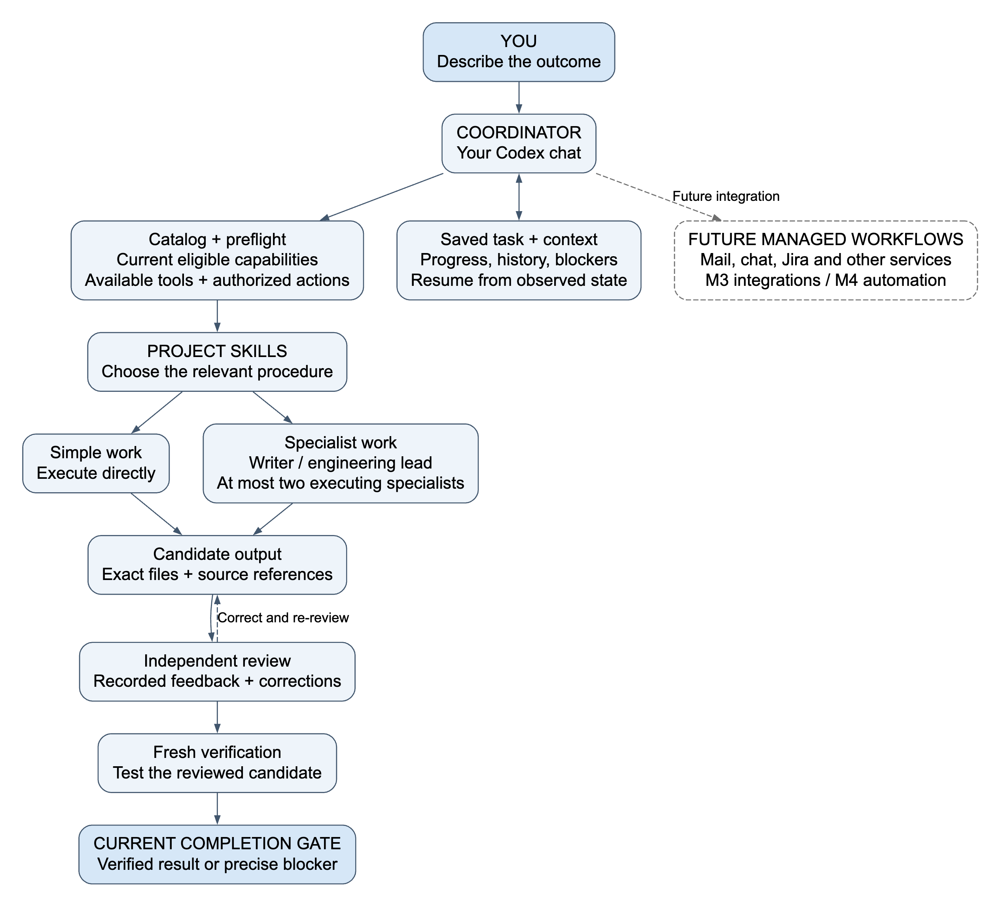

# Smart Assistant: the whole picture

Smart Assistant is a working local assistant framework inside Codex. You describe an outcome; Codex chooses relevant workflows and specialists, while the project's Python helpers preserve task state and check eligibility, permissions and completion evidence. Its selected M1/M2 foundation is accepted. External-service workflows and recurring operation remain later milestones.

## How it fits together

The coordinator is the main chat agent. Semantic routing happens through Codex and the skills' instructions; the Python package supplies deterministic validation and storage. This is not a continuously running background service. The reviewer role described below specializes in local reports; other development reviews used separate advisory agents.

Every project task follows **design → implement → independent review → recorded feedback → test → repeat**. A missing required input/tool or failed required child preserves progress and blocks completion. Code workers use isolated worktrees; dependent work runs sequentially. The default correction ceiling is three cycles, with at most two specialists executing across a delegation tree, subject to smaller host/task limits.

## What has been completed

| Package | Delivered capability |
| --- | --- |
| P00 | Shared versioned records, validation contracts, project scaffolding and Git baseline |
| P01 | Revisioned task storage, conflict checks, scoped context and explicit recovery/history |
| P02 | Capability catalog, complete asset manifests, eligibility, serialized deployment/disable transactions and restoration |
| P03 | Tool/authorization preflight, source/criteria fingerprints and review/feedback/test completion checks |
| P04 | JSON CLI and chat coordination workflow for saving, resuming and completing tasks |
| P05 | Agent definition validation, immutable private staging and managed lifecycle workflow |
| P06 | Skill validation, complete-resource staging and managed lifecycle workflow |
| P07 | Local notes-to-report writing, source maps and independent report verification |
| P08 | Engineering lead, bounded delegation, ownership/handoff checks, child blockers and integration review |
| P09 | Cross-package regressions, actual native observations, isolated lifecycle evaluations and integrated acceptance |

The final reviewed P09 candidate passed **323 tests on macOS and323 on Linux**, and all12 criteria passed the actual saved-task completion gate. Native client observations cover macOS; Linux evidence covers the Python helpers. Failed runs and corrections remain in evidence. The backlog still contains all50 original items and16 proposals with broad partial/future statuses intact. Package completion does not mean every backlog capability is Done. See current acceptance (local historical archive: `evidence/p09/acceptance.md`), coverage (local historical archive: `evidence/p09/coverage.md`) and [backlog](capability-backlog.md).

## All permanent project agents

| Agent | Current version/status | Actual responsibility |
| --- | --- | --- |
| writer | 2.0.0 ACTIVE | Turn supplied local notes into Summary, Decisions, Action items and Open questions; preserve facts and produce a source map |
| reviewer | 2.0.0 ACTIVE | Independently compare that report and source map with original notes and current acceptance evidence; report findings |
| engineering-lead | 1.0.0 ACTIVE | Divide suitable engineering work, assign exact ownership/dependencies, supervise bounded specialists and coordinate accepted handoffs |

These are the three definitions in [.codex/agents](../.codex/agents). They are reusable roles invoked when needed, not three permanent background processes. All currently inherit the parent model and reasoning effort.

**Coordinator** and **capability manager** are responsibilities provided by the main chat and management workflows, not additional custom agent definitions. Codex also supplies native default/worker/explorer agent types. During development we used temporary package implementers, scenario workers, documentation workers and independent reviewers across P01–P09. Their worktrees/evidence are retained; they are not additional ACTIVE product roles. P09's p09-tally-agent and p09-list-tally were disposable evaluation capabilities in an isolated project, not additions to the canonical catalog. Researcher, designer, email specialist and domain expert roles are future additions.

## All six project skills

| Skill | Availability | Purpose |
| --- | --- | --- |
| request-coordination | Bootstrap workflow, available in this project | Capture a durable request, load scoped context, select/preflight capabilities, preserve progress and request genuine completion |
| manage-agent | Bootstrap workflow, available in this project | Design, validate, stage, evaluate, activate, update, disable and restore a specialist |
| manage-skill | Bootstrap workflow, available in this project | Manage a reusable procedure, its resources, behavioral evaluation and lifecycle |
| draft-document | 1.0.0 ACTIVE managed skill | Draft the supported four-section report from supplied local notes |
| verify-completion | 1.0.0 ACTIVE managed skill | Independently verify that report and its source/evidence bindings |
| delegate-work | 1.0.0 ACTIVE managed skill | Assign bounded independent work, check handoffs and integrate reviewed results |

Files live in [.agents/skills](../.agents/skills). The catalog's **six ACTIVE records are three agents plus three managed skills**. The three bootstrap skills establish and operate the catalog without fictitious ACTIVE self-records. Fresh discovery, current eligibility and preflight still apply to a request.

An **agent** defines a responsibility; a **skill** defines a repeatable procedure; a **tool** performs an operation; a **plugin** packages skills/connectors/MCP capabilities. Skills can match ordinary requests implicitly, so you can state your outcome without remembering role names. [Official skills guidance](https://learn.chatgpt.com/docs/build-skills)

## Tools and plugins used versus available

| Component | Use in this work |
| --- | --- |
| Codex desktop, installed Codex CLI and native app-server observations | Chat reasoning, real configured agent invocation, skill discovery, source evaluations and native lifecycle proof |
| Shell/file tools and rg | Read/edit local files, run commands, inspect current candidates and collect evidence |
| Agent collaboration tools | Spawn, message/follow up, wait, inspect or stop temporary specialist work |
| Python standard library and unittest | Twelve package modules, JSON/TOML records, validation/storage, hashing, CLI and323 functional/integration tests |
| Git and isolated worktrees | Separate independent code changes, integrate serially, preserve history and create local commits;13 worktrees retained |
| Docker on the existing Rancher runtime | Disposable offline Linux test execution; not an assistant backend |
| GitHub public release downloads | Obtain the checksum-pinned standalone Linux Python runtime for testing; not a connected GitHub business workflow |
| Superpowers skills/plugin | Planning, worktrees, TDD, debugging, independent review, feedback and verification discipline |
| Native web search and OpenAI Docs | Verify relevant official product/extension documentation |
| Visualization and Plugin Management | Architecture picture and current integration-directory metadata for this overview |
| Bundled Graphviz/Viz.js, Playwright and headless Chrome | Locally compile and visually check this overview diagram using a fresh temporary browser profile; no user browser profile or mail/chat data |

Development guidance included using-superpowers, brainstorming, writing-plans, executing-plans, using-git-worktrees, dispatching-parallel-agents, subagent-driven-development, test-driven-development, systematic-debugging, requesting-code-review, receiving-code-review, verification-before-completion, finishing-a-development-branch and writing-skills. These development skills are separate from the six Smart Assistant project skills.

The local Codex configuration lists enabled plugin entries for Documents, Spreadsheets, Presentations, Superpowers, Expo, Codex Security, Slack, Browser, PDF, Template Creator, Visualize, Codex App Tools, Unified Computer Use, Computer Use, Code Review and Chrome. Configured entries are not proof that each connection works or that each was used. Reviews here were performed by independent agents; a configured Code Review plugin is a separate capability. Other session-provided services include Outlook Email, Jira, Confluence, Pages and additional utilities; no blanket service-authentication claim is made.

The plugin directory currently reports **Outlook Email and Slack installed/enabled**, Outlook Calendar available but not installed, and Gmail unavailable under current admin policy. This inspection read directory metadata only. Smart Assistant has no accepted managed mail/chat workflow yet; we did not read your mail/chat data or send messages during acceptance. Connection/account/action access must be verified when implementing a real integration. No recurring routine was created.

## How mail, chat and other integrations fit

Use an existing authorized connector first. For a service without suitable exposed tools, add an MCP adapter that makes its API operations available, then wrap the intended procedure in a skill. A plugin can distribute the skills and connector together. Official guidance covers [MCP configuration/authentication](https://learn.chatgpt.com/docs/extend/mcp?surface=cli) and [plugin packaging](https://developers.openai.com/plugins).

For example, a future **work brief** could retrieve selected Outlook messages and Slack threads, extract decisions/actions with source links, draft a brief and independently verify it. Its first release should run on request with explicit source scope. Sending a reply or posting to a channel is a separate requested action with its own authorization, destination, outcome verification and duplicate-prevention/recovery rules. Scheduling arrives only after the underlying workflow is reliable and recurring execution is requested.

| Extension layer | What to add |
| --- | --- |
| Tool access | Verify the actual account, available read/write operations and required permissions; keep secrets outside committed records |
| Skill | Define when it triggers, approved sources, output format, missing-tool behavior and verification |
| Optional agent | Add a distinct recurring responsibility only if the workflow needs it; reuse writer/coordinator where suitable |
| Catalog/lifecycle | Stage a new version, independently review/evaluate it, prepare deployment and obtain fresh native discovery/invocation proof before ACTIVE |
| Task evidence | Save source identities, progress, blockers, action outcomes and current review/check receipts |
| Later automation | Define cadence/event behavior, deduplication, failure recovery and notifications using a supported runtime |

M3 covers external integrations, M4 recurring/event work, and M5 broader advanced capabilities such as cloud execution. Model/reasoning routing remains **Proposed T24 in M2**; broader cost/usage enforcement also needs separate work. These extensions require their own designs and implementations.

## Adding and specializing an agent

You can request an outcome directly, for example:

> Add an Oracle Xstore specialist that answers from approved, versioned documentation and project context, explains its evidence, and proposes verification steps. Ask for the Xstore version when it materially changes the answer. Do not alter customer environments without a separate authorized task.

The manage-agent workflow checks overlap, designs the role, writes a non-native source, validates/stages a DRAFT, obtains independent review and behavioral tests, then prepares and activates only with fresh native proof. Missing tools or an unavailable native role leave a precise blocker and DRAFT, not a claimed activation. You do not have to edit TOML yourself.

Our current supported agent definition uses **name, description and developer_instructions**. Native targets live under .codex/agents/<name>.toml. The project's current validator deliberately rejects model/effort overrides and other optional configuration; keep inheritance until a separately designed extension supports them. Codex's broader native format supports additional fields, but parent permissions/MCP access still govern the role. [Official custom-agent guidance](https://learn.chatgpt.com/docs/agent-configuration/subagents)

Expertise comes from:

1. **A narrow responsibility:** clearly define what it should answer and when another workflow owns the task.
2. **Authoritative knowledge:** approved manuals, project architecture, version constraints, known exceptions and source priorities. Load the relevant subset for each task.
3. **Repeatable skills:** diagnostic procedures, output formats and verification steps kept separate from the role description.
4. **Real tools:** retrieve the required evidence through available authorized tools; listing a dependency does not grant access.
5. **Representative evaluations:** ordinary requests, incomplete inputs, conflicting/stale sources, unrelated requests, missing tools and source-embedded instructions treated as data.
6. **Maintenance:** update knowledge and versions, preserve prior evidence, independently review changes and retest before activation.

Calling a role an expert does not train new model weights. Instructions, grounded knowledge, tools and demonstrated evaluation results determine its useful specialization.

## Suggested next work

Start with one narrow M3 workflow using the already-listed Outlook/Slack plugins: **an on-demand, source-linked work brief**. Reuse coordination and writing, and extend verification for external-source claims because the current reviewer is scoped to local reports. Validate actual account/tool access and source behavior before adding external sends or recurring execution.

Next, add one domain specialist tied to real recurring work, such as Oracle Xstore. Give it a versioned knowledge pack and a small realistic evaluation set. Add further roles only when their responsibility differs materially from an existing one.

Keep this overview as the entry point; use the [system design](superpowers/specs/2026-10-12-smart-assistant-system-design.md), [implementation plan](superpowers/plans/2026-10-12-smart-assistant-implementation-plan.md) and package evidence for detailed contracts. The coordinator should handle role selection and lifecycle mechanics behind your ordinary requests.
