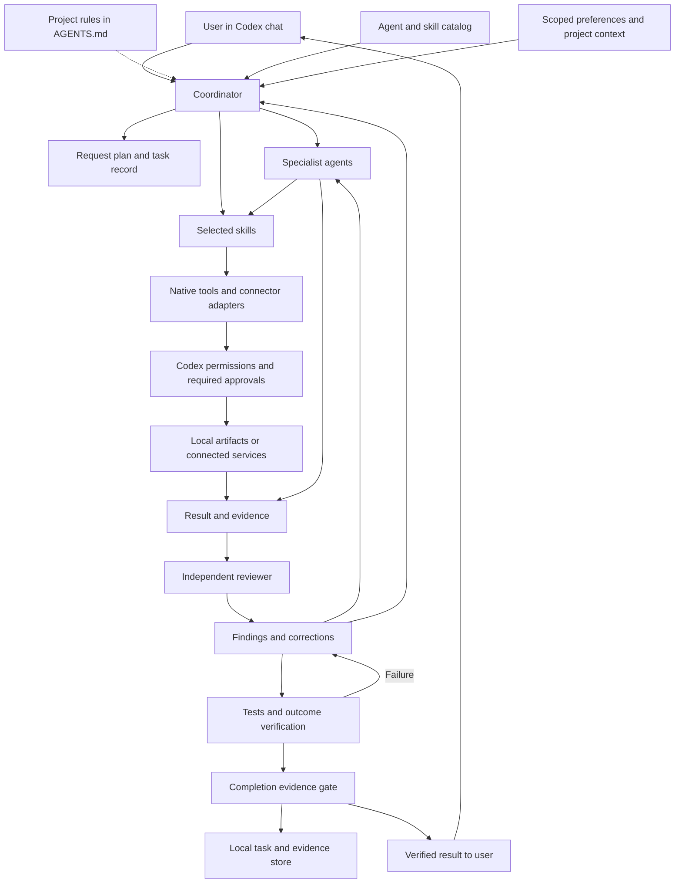
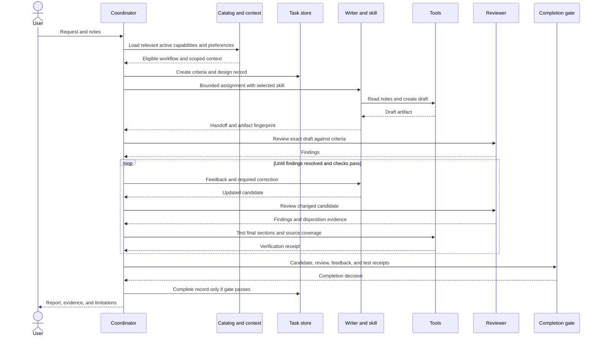
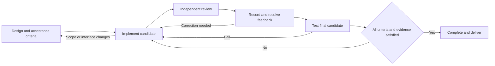
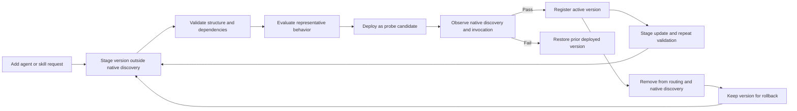
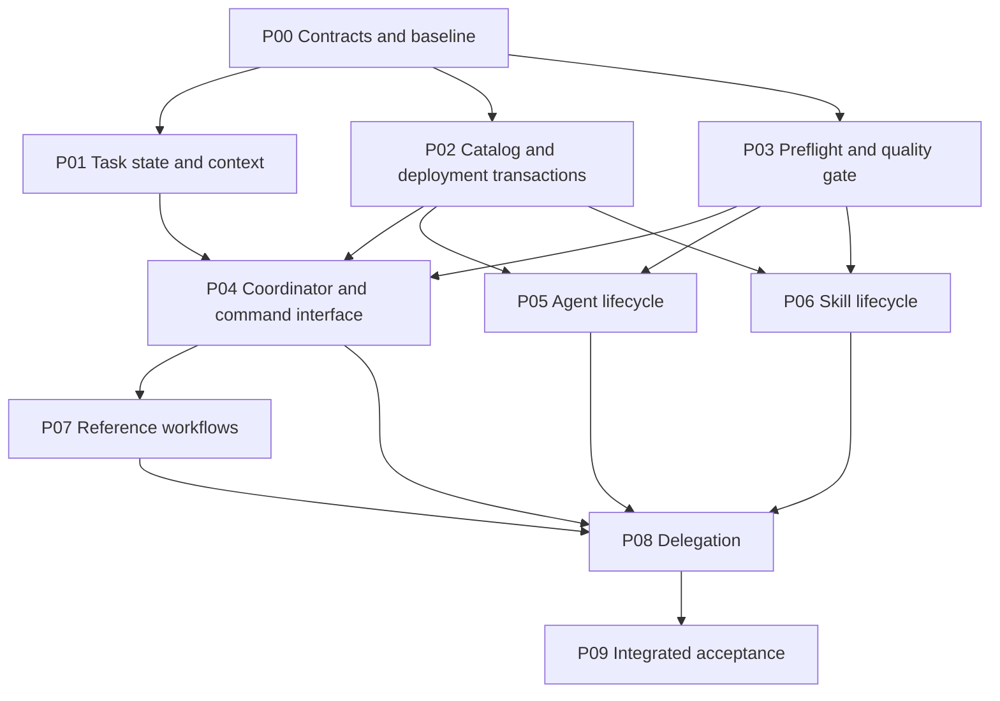

# Smart Assistant System Design

Status: independently reviewed architecture with the P00 wire contract frozen for implementation. Scope: M1 and M2, with extension boundaries for M3 through M5.

The user should be able to chat with one coordinator, receive a verified result, and add new agents and skills without redesigning the assistant. Every task follows design, implementation, independent review, feedback, and testing; corrections repeat that cycle. Use Codex as the conversation and agent runtime. Add small deterministic local helpers for records, capability validation, and evidence checks.

## Design decisions

| Option | Consequence | Decision |
| --- | --- | --- |
| Instructions and skills only | Minimal setup, but record consistency and completion evidence rely entirely on prose | Use for behavior guidance, with local helpers for repeatable checks |
| Codex plus deterministic local helpers | Keeps the existing chat interface while making state and validation predictable | Selected for M1 and M2 |
| Standalone application and agent backend | Adds an independent UI, job system, and deployment responsibilities | Defer until native client limits justify it |

The coordinator is the primary Codex agent, not a separate model service. The router is its decision process, guided by an active catalog and skills. A role is a specialist configuration, a skill is a reusable procedure, a tool executes an operation, and a routine supplies a trigger. Catalogs do not execute models or grant permissions.

## Global constraints

- First release uses the existing Codex chat interface; no custom frontend, LLM API service, or always-on daemon.
- Local helpers use Python 3.11 or later and the standard library; first release supports macOS and Linux.
- All tasks follow design → implement → independent review → feedback → test → repeat until acceptance criteria are satisfied.
- Completion evidence binds to the final candidate fingerprint; changed candidates require fresh review and relevant testing.
- The coordinator is the only writer of shared live task state and active capability deployment.
- Each test and development worktree uses an isolated state directory; no tests read or modify live user state.
- Agent and skill activation requires structural validation, behavior evaluation, and native discovery evidence.
- Runtime instructions, catalogs, and helper validation do not override Codex permissions or create new authorization.
- First release performs on-demand local workflows; external writes, recurring schedules, and event listeners are later milestones.
- No capability backlog item is Done merely because its design or definition file exists.

## Component coordination



Solid arrows describe information or action flow. The project guidance applies to all project agents and skills, including the review cycle. Tools and permission checks are part of the host environment; the project does not replace their enforcement.

| Component | Responsibility | Interface | Owner |
| --- | --- | --- | --- |
| Coordinator | Interpret intent, select workflow, manage dependencies, integrate results | RequestEnvelope and TaskRecord | Primary chat agent |
| Capability catalog | List eligible roles and skills, versions, dependencies, and deployment fingerprints | CapabilityRecord | Capability manager, writes through coordinator |
| Context loader | Retrieve only relevant preferences and source-backed project facts | ContextBundle | Coordinator |
| Skill | Define steps, output contract, and outcome checks | SKILL.md plus scoped resources | Capability manager |
| Specialist | Execute a bounded assignment using selected skills and tools | TaskAssignment to Handoff | Assigned worker |
| Tool preflight | Check required tool availability and action authorization | PreflightResult | Coordinator |
| Task store | Preserve revisions, artifacts, checkpoints, and iteration history | TaskRecord and atomic update API | Coordinator |
| Reviewer | Identify acceptance, correctness, interface, and permission failures | ReviewReceipt | Independent agent |
| Completion gate | Reject missing, stale, or failing evidence | GateResult | Deterministic helper plus coordinator |
| Integration owner | Combine branches, resolve interface changes, update backlog | Candidate snapshot and integration receipt | Coordinator or designated integrator |

## One request from start to finish

Example: "Use these notes to draft my weekly report, then check that every requested section is covered."



The loop has a zero-correction path: a candidate with no review findings proceeds directly to feedback recorded as "no findings" and testing. Missing essential input creates a Waiting for input record. Missing required approval creates Waiting for approval. Neither state is a completed result.

## Required work cycle



A task is complete only when its criteria are covered, its current artifact snapshot has independent review, every actionable finding is resolved or rejected with evidence, and final relevant checks pass. Tests before review help development but do not replace final tests after feedback. A changed candidate invalidates prior review and test bindings. A child task passing does not prove the integrated parent result.

Review-only tasks produce a findings artifact, which the coordinator checks for supported observations. They do not recursively spawn reviewers for their review. Documentation uses coverage, links, diagrams, and consistency checks; code uses functional and integration tests; role and skill changes use activation and behavior cases.

Default execution limits are three correction cycles per dispatch and at most two simultaneously executing specialists, subject to host capacity. Reaching a limit preserves evidence and a precise remaining failure; it never marks the task complete. The coordinator may continue with a fresh bounded dispatch under the existing authorization and remaining runtime budget. These limits bound each dispatch, not the user's overall objective.

## Local helper boundaries and contracts

Helpers validate and persist records. They do not call a model, select a role using keywords, invoke arbitrary connectors, approve actions, or determine whether prose is useful. The coordinator supplies semantic decisions; reviewers assess evidence quality. Structural completion validation is not an unbypassable boundary around all Codex tool use.

Version 1 contracts live in `smart_assistant/contracts.py` and are serialized as JSON. Record IDs match `^[a-z][a-z0-9_-]{1,63}$`. Versions use three non-negative decimal components such as `1.0.0`. Timestamps use UTC ISO 8601 with a `Z` suffix. Artifact paths resolve under the selected artifact root and reject traversal or symlink escape.

| Contract | Required fields |
| --- | --- |
| RequestEnvelope | schema_version=1, request_id, text, project_id, source_refs, requested_role or null |
| ContextBundle | schema_version=1, project_id, preferences object, facts containing text, scope, source_ref, and observed_at |
| Criterion | id, description, verification_method |
| RequestedAction | action_ref, kind=read_local or write_local or external_read or external_write, resource_ref, required_tool or null, host_decision=allowed or approval_required or denied or unknown |
| AuthorizationScope | action_kind, resource_ref, source_ref; exact scope and destination references, no inferred permission from a role |
| Selection | catalog_revision, agents and skills containing id, version, and deployed_sha256 |
| Limits | max_correction_cycles=3, max_parallel_children=2 |
| Artifact | id, relative_path, sha256 |
| CandidateSnapshot | artifact list sorted by ID; candidate_id is SHA-256 of canonical UTF-8 JSON using sorted keys and compact separators |
| AcceptanceSnapshot | criteria sorted by ID plus SHA-256 of the referenced design file; acceptance_id is SHA-256 of canonical JSON for those fields |
| Finding | id, severity, description, criterion_ids |
| Disposition | finding_id, decision=corrected or rejected, reason, evidence_refs |
| ReviewReceipt | reviewer_ref, implementer_ref, candidate_id, acceptance_id, observed_at, findings |
| CheckReceipt | check_id, criterion_ids, candidate_id, acceptance_id, method=command or observation, command or observation description, environment, outcome=pass or fail, evidence_ref, observed_at |
| CycleEvidence | cycle_number, design_ref, candidate snapshot, acceptance snapshot, review, dispositions, checks |
| TaskRecord | schema_version=1, id, revision, request, status, phase, parent_task_id or null, capability_ids, criteria, selection, limits, authorization scopes, requested actions, cycles, blockers, resume_next_step, artifact_root |
| TaskAssignment | task_id, assignment_revision, role_id, selected_skill_ids, design_ref, criteria, context, owned_paths, selection, limits |
| Handoff | schema_version=1, task_id, assignment_revision, role_id, result=ready_for_review or blocked or failed, artifacts, criteria_coverage, evidence_refs, blocker or null, next_step |
| PreflightResult | ready boolean, missing_tools, pending_actions containing action_ref and reason |
| ErrorDetail | code, path, message |
| GateResult | passed boolean, errors as ErrorDetail records |

Common helper exceptions are `ValidationError` and `RevisionConflict`, both exported by contracts. A GateResult's `passed` is true only when errors is empty. Preflight matches exact action kind and resource reference; a missing scope, unknown host decision, required approval, or denied host decision makes `ready` false. Helpers never synthesize an allowed host decision or obtain approval themselves.

Design and local evidence references resolve under the task's artifact root using the same escape checks as artifacts. The completion gate recomputes the acceptance snapshot from current criteria and design bytes. Changing a description, verification method, or design invalidates prior receipts even when criterion IDs and artifact bytes remain unchanged. Candidate snapshots exclude the review and check receipts themselves.

| Capability lifecycle contract | Required fields |
| --- | --- |
| DeploymentManifest | files sorted by relative path, each containing relative_path and sha256; manifest_sha256 of canonical JSON for the complete file list |
| NativeProbeReceipt | schema_version=1, operation_id, capability_id, version, manifest_sha256, purpose=activate or disable, client_name, client_version, session_ref, discovered boolean, invoked boolean or null, observed_at, evidence_refs |
| PreflightRequest | schema_version=1, required_tools, available_tools, requested_actions, authorization scopes |

The deployment manifest covers the complete skill tree, including SKILL.md, scripts, references, assets, and optional invocation metadata. A single agent definition is a one-file manifest. Reject symlinks, traversal, and files outside the staged root. Eligibility rehashes deployed contents and rejects manifest drift. Activation requires matching operation, identity, version, and manifest, with discovered=true and invoked=true. Disable requires a fresh-session absence observation with purpose=disable, discovered=false, and invoked=null; its manifest identifies the removed version. Evaluation evidence also binds to that manifest.

Task statuses are queued, running, waiting_input, waiting_approval, verifying, completed, failed, paused, and cancelled. Phases are design, implement, review, feedback, and testing. Store status and phase separately. Only completion may enter completed and it must pass the completion gate.

Ordinary transitions are queued → running; running → waiting_input, waiting_approval, verifying, paused, failed, or cancelled; waiting_input and waiting_approval → running or cancelled; verifying → running, completed, failed, paused, or cancelled; paused → running or cancelled; failed → running only through an explicit resume event. Completed and cancelled are terminal; create a new task for follow-up work.

One coordinator process writes an individual live task. The helper also uses an exclusive file lock, expected revision checks, and atomic file replacement to reject accidental concurrent overwrites. Reads never mutate records. Runtime state defaults to ignored `.smart-assistant/state/`; all APIs accept an explicit state root. Tests must use temporary roots.

## Capability lifecycle



`CapabilityRecord` contains schema_version=1, id, kind=agent or skill, name, version, state=draft or active or disabled or retired, source_path, deployed_path or null, deployed_sha256 or null, triggers, boundaries, required_inputs, output_contract_ref, tool_dependencies, validation_refs, discovery_probe_ref or null, and rollback_ref or null. `CapabilityCatalog` contains schema_version=1, revision, and records.

CapabilityRecord.deployed_sha256 and each selected capability’s deployed_sha256 identify the complete DeploymentManifest.manifest_sha256, including a one-file agent manifest. Per-file SHA-256 values remain separate. The frozen exact v1 wire fields and nested types are documented in [P00 contract design](../../tasks/p00/design.md). Failed native probe observations remain structurally valid records; lifecycle eligibility requires the successful discovery/invocation or absence conditions.

The catalog is an index of versions and deployment evidence. Actual instructions live in native assets. Do not duplicate complete role instructions in registry metadata.

An activation has two steps. Prepare validates a staged candidate, evaluates it, records a deployment journal, and exposes it for a controlled native probe. Finalize registers it Active only after discovery and invocation evidence. During a probe, the candidate can be discoverable to Codex but is not yet routable by the project coordinator. Probe changes run in an isolated development checkout; production activation is serialized and restored on failed probes. An interrupted journal must be reconciled before another deployment. Eligibility is unavailable for a capability with a pending deployment or disable journal, so readers cannot route work against partially replaced assets.

A Disabled flag in a catalog alone does not prevent native implicit invocation. Prepare-disable immediately excludes the capability from routing, archives/removes its deployed asset, and records a journal. Finalize-disable accepts only a NativeProbeReceipt proving absence in a fresh session; a failed or interrupted probe keeps it unavailable until restore or reconciliation. A role or skill with missing native discovery evidence cannot be Active. Version replacement and rollback use the same lifecycle checks.

Codex supports project agent definitions under `.codex/agents/` and skills under `.agents/skills/`. Verify discovery in the installed client; configuration or instruction changes can require a fresh session. [Agent configuration](https://learn.chatgpt.com/docs/agent-configuration/subagents), [Skill discovery](https://learn.chatgpt.com/docs/build-skills)

## Tools authorization and context

Use native tools and existing connectors first. Preflight compares workflow tool dependencies with an observed tool inventory. A role's listed tools are dependencies, not permission grants. Authorization includes its user-source reference, scope, and relevant destination; tool and platform approval requirements remain authoritative.

M1 and M2 use user-supplied notes, local research fixtures, and local draft artifacts. Connector reads and external writes arrive in M3. Do not retry a later external write after uncertain success without checking its destination and deduplication record.

Keep personal preferences and private facts in ignored runtime context by default. Commit only synthetic examples. Load context scoped to the request and role; specialists receive the minimum needed context, not all user history. Preserve source references and timestamps so stale facts can be rechecked.

## Proposed implementation layout

```text
AGENTS.md                              Mandatory rules for all project workers
smart_assistant/contracts.py                       Shared versioned record types and validation
smart_assistant/state.py                           Atomic task storage and transitions
smart_assistant/context.py                         Scoped preference and context reads
smart_assistant/catalog.py                         Eligibility and deployment metadata validation
smart_assistant/quality.py                         Candidate fingerprints and completion evidence
smart_assistant/preflight.py                       Tool availability and authorization preflight
smart_assistant/lifecycle.py                       Serialized deployment journal and recovery
smart_assistant/agent_lifecycle.py                  Agent-specific staging and validation
smart_assistant/skill_lifecycle.py                  Skill-specific staging and validation
smart_assistant/cli.py and smart_assistant/__main__.py          Deterministic command entry points
.agents/skills/                        Deployed reusable procedures
.codex/agents/                         Deployed specialist definitions
capabilities/staging/                  Draft definitions outside native discovery
capabilities/catalog.json              Versioned project capability index
examples/                              Synthetic inputs and expected outcomes
tests/                                 Unit and integrated helper behavior
docs/evidence/                         Sanitized development review and test evidence
.smart-assistant/state/                            Ignored live task records and private context
```

Folders shown above are planned interfaces and ownership boundaries, not files already installed. The package is directly importable from the project root; no package installation is required for the initial helper commands.

## Parallel delivery and worktrees



Commit the accepted contracts before P01, P02, and P03 run concurrently. Then P04, P05, and P06 can run concurrently against that baseline. P07 and P08 follow their dependencies; P09 verifies the integrated result. Every package includes its own design and required review cycle.

P00 establishes a local Git baseline before worktree creation. The planning baseline now exists on p00-foundation; accepted contract integration is tracked in P00 progress (local historical archive: `../../evidence/p00/progress.md`). Use separate worktrees and disjoint file ownership for implementation; one integrator handles shared configuration, canonical catalog updates, backlog statuses, and final commits. Worktree tests use synthetic state, never a shared live state directory. Git isolates checked-out files, not external account writes or private runtime records. [Codex worktrees](https://learn.chatgpt.com/docs/environments/git-worktrees)

Four current agent slots include the coordinator. Run up to three implementation workers when no reviewer is needed, then reuse a freed slot for independent review; or reserve one reviewer and run two workers. Do not infer unlimited execution capacity from the number of worktrees.

## Acceptance and boundaries

M1 must demonstrate a normal local drafting request, essential clarification, a missing-tool blocker, interrupted-task resume, and refusal to complete with stale or failing evidence. M2 must demonstrate adding an agent and skill, direct and indirect selection, unrelated-request rejection, disable and rollback, bounded delegation, and integrated verification.

Recurring schedules, external event listeners, purchases, production publishing, automatic merging, Figma workflows, and cloud coding are separate later packages. Local scheduled work depends on the native scheduler's requirements; an instruction file does not supply a daemon. The original 66-entry capability backlog remains intact, with selected first-release coverage tracked by package.

The design review checks native discovery drift, concurrent writes, stale evidence, authorization confusion, and review recursion. Automated checks confirm record structure and test behavior; human or independent agent judgment remains necessary for semantic quality and native client observations.
