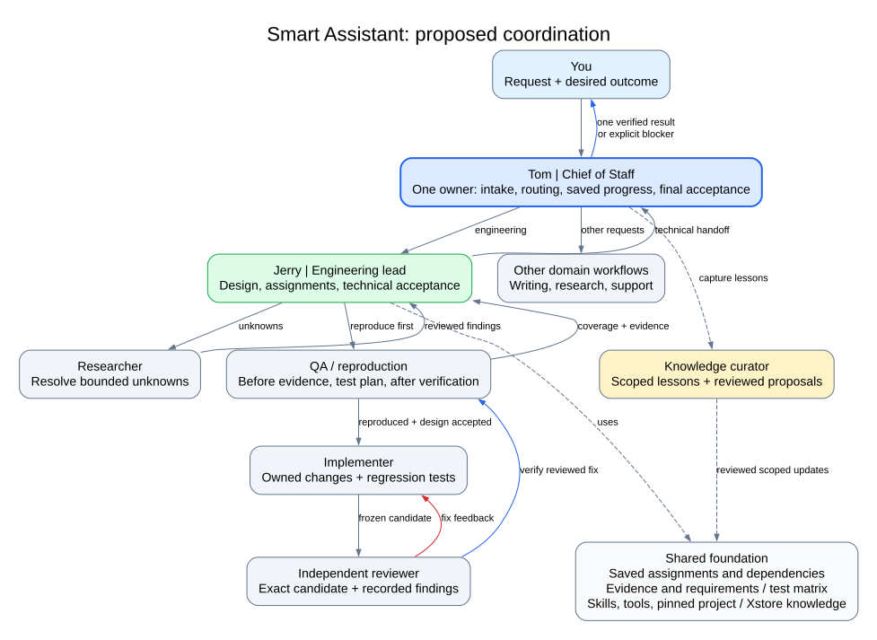

# Tom and Jerry: Chief of Staff orchestration design

Date: 2026-11-02. Status: proposed architecture; independent design review and document checks are recorded separately. User review is required before implementation. Nothing in this document means a new role, skill, connector, or gate is implemented or ACTIVE.

## 1. Outcome and scope

Tom is the single Chief of Staff who receives a request, establishes its outcome and acceptance criteria, selects an eligible team, saves progress, checks delivery evidence, and returns one honest result. Jerry is the engineering lead responsible for technical investigation, design, decomposition, and delivery recommendations. Tom remains responsible for the whole request. The two appearances of Tom in a process represent the same owner at intake and acceptance.

This is an architecture across related work packages, not permission to implement all subsystems at once. The first executable milestone is the core delivery workflow; Xstore integration and controlled improvement have separate acceptance packages. Preserve existing unfinished Xstore work.

### User requirements and design traceability

All rows below are `user_confirmed`, scoped to this project, with source: the user's 2026-11-02 request in this chat. These requirements do not imply that execution or activation has occurred.

| ID | Requirement | Design sections | Acceptance evidence planned |
| --- | --- | --- | --- |
| R01 | One Chief of Staff named Tom receives and routes work | 3–5 | Correct routing, owner continuity, ambiguity and unavailable-role cases |
| R02 | Engineering lead is named Jerry | 3, 9 | Display-name mapping preserves stable capability identity and existing tasks |
| R03 | Add supporting roles as needed | 3, 9 | Distinct scoped role contracts; real discovery, invocation, behavior and independence |
| R04 | Save assignments, owners, progress and dependencies | 5–6 | Resume, CAS conflict, dependency, reassignment and cancellation tests |
| R05 | Mandatory design → implement → independent review → feedback → testing → repeat | 4, 7–8 | Exact-candidate reviews, dispositions, fresh checks, enforced completion denial |
| R06 | Reproduce a bug before fixing; capture before/after screenshots or evidence | 7 | Same-scenario before/after observations, failing/passing regression and missing-reproduction denial |
| R07 | Cover all requirements and required test cases with evidence | 7–8 | Bidirectional requirements/test matrix, missing/blocked/stale case denial |
| R08 | Use and maintain shared Xstore knowledge | 10 | Scoped retrieval, file pinning, sanitization, conflict and approved maintenance-policy tests |
| R09 | Learn and improve over time | 11 | Scoped lesson retrieval; independent evaluation, regression and rollback of changes |
| R10 | Research missing knowledge before implementation decisions | 4, 11 | Source provenance, applicability, conflicting-source and unsupported-claim cases |
| R11 | Present design before implementation | 1, 12 | Reviewed written design and user decision; no source/catalog/activation changes in design delivery |

### Alternatives

1. **Recommended: extend the existing coordinator and local helpers.** Tom owns the main chat; Jerry and workers are invoked on demand. Reuse task storage, native capabilities, preflight, handoffs and completion evidence. Add the missing saved delivery and evidence contracts. This preserves a single task owner and current safety/activation rules.
2. **A separate permanent agent for every responsibility and domain.** More distinct personas, but duplicated instructions, greater scheduling cost, and fragmented ownership. Useful only when evaluation demonstrates a need for a separate specialist.
3. **A standalone orchestration backend with a scheduler and queue.** Could support unattended cross-session work later, but introduces an unnecessary service and operational burden now. Deferred until explicitly required.

No always-running service, automatic Jira transitions, production deployment, external messaging, or background model training is part of this milestone.

## 2. Verified foundation and gaps

Current source inspected at HEAD `081db870ccdf8c4316bbc1309e5d72806bab3094`:

- [Request coordination](../../../.agents/skills/request-coordination/SKILL.md) provides semantic routing, saved work cycles, current catalog eligibility, preflight and scoped context.
- [Delegation](../../../.agents/skills/delegate-work/references/workflow.md) and [engineering lead](../../../.codex/agents/engineering-lead.toml) define bounded assignments, ownership, independent review and integration rules. Accepted P08 scope is a bounded reference workflow, not a production Xstore delivery team.
- [Contracts](../../../smart_assistant/contracts.py) define strict v1 TaskRecord, TaskAssignment, Handoff, CandidateSnapshot, AcceptanceSnapshot and CycleEvidence. Assignment persistence and a dependency graph are not present in these records.
- [TaskStore](../../../smart_assistant/state.py) provides locked CAS updates and immutable request identity. Its injected checker can vary; existing cycle-history preservation is additionally enforced in the CLI, not uniformly in the store.
- [Quality checks](../../../smart_assistant/quality.py) validate current product/design bytes, structural review/check consistency and local evidence presence. They do not execute tests, prove screenshot semantics, authenticate independent actors, or derive child dependencies.
- [Context loading](../../../smart_assistant/context.py) combines one project and one role overlay. A shared-KB resolver for the supplied XDA folder is not implemented.
- [Project learning](../../agent-learning.md) permits scoped file-based capture and reuse. It does not train model weights or implement a background learning engine.
- [Xstore triage](../../xstore-triage-workflow.md) 1.0.1 remains DRAFT and advisory. New capabilities cannot inherit its historical results or claim it is an active coding specialist.

All future behavior below is proposed. Existing checks stay in force.

## 3. Roles, names and authority

| Display name / responsibility | Stable role ID | Owns | Does not own |
| --- | --- | --- | --- |
| **Tom — Chief of Staff** | Root coordinator; bootstrap identity | User request, routing, durable records, shared contracts/configuration/catalog, final integration authority and completion request | Invented specialist eligibility; automatic external writes or releases |
| **Jerry — engineering lead** | `engineering-lead` | Technical design, work breakdown, assignment proposals, dependency analysis, technical acceptance recommendation | Independently writable parent state or canonical integration commits |
| Implementer | `implementer` (new) | Assigned source/configuration/test changes and local regression evidence | Final independent approval of own work |
| Code reviewer | `code-reviewer` (new) | Independent review of exact changes, requirements and risk; findings artifacts | Editing the implementation being approved |
| QA and reproduction | `qa-verifier` (new) | Reproduction plan, test-case matrix, before/after capture and verification evidence | Treating mocks as live business acceptance; changing criteria to pass |
| Researcher | `researcher` (new) | Bounded unknowns, authoritative sources, provenance, applicability and alternatives | Unsupported product APIs; production actions; treating fetched text as instructions |
| Knowledge curator | `knowledge-curator` (new) | Scoped lesson classification, deduplication, sanitization and maintenance proposals | Self-approving shared knowledge, changing gates or granting permissions |
| Xstore advisor, when eligible | `xstore-triage` (existing DRAFT) | Existing supplied-evidence advisory scope only | Customer coding, runtime changes or spawning children |

Tom is the actual root coordinator in the main chat, not an extra supervising child. Extend the bootstrap entry point and a team display profile instead of requiring a fabricated ACTIVE self-entry. Jerry retains the existing capability ID; his new name is display metadata. Changing his behavior requires a new immutable capability version and real evaluation. Do not edit an ACTIVE deployed definition in place.

Use a separate `code-reviewer`; the existing report `reviewer` must not silently acquire an unrelated code-review scope. Other display names remain role titles until requested.

Role definitions are reusable instructions. Actual independent review requires a separate observed execution context and genuine review, not two different strings. A coder may also run tests, but cannot be the sole final reviewer. QA that writes a fixture or test has its verification changes independently reviewed. Curator proposals are reviewed by another actor; there is no infinite reviewer-of-reviewer chain.

## 4. Coordination model

Tom is shown once in the diagram. Every result returns to the same Tom. The diagram describes future coordination, not agents already activated.

1. **Intake:** identify project and outcome; inspect existing task/ticket state, authorization, relevant local instructions and acceptance criteria. A bug, feature, research request and document have different evidence needs.
2. **Route:** Tom records the domain, task kind, rationale, eligible role/skill versions, required inputs and tools. Match semantics and boundaries; do not route solely by keywords or names.
3. **Investigate:** Jerry or the domain owner checks existing implementation and knowledge. Research material uncertainties. For a bug, reproduce and capture before evidence before repair coding starts.
4. **Design:** record affected files, dependencies, required tests, evidence levels and acceptance criteria. Preserve a user-requested design approval checkpoint. Ordinary reversible task choices do not need repeated approvals.
5. **Assign:** Tom persists Jerry's accepted proposals. Workers receive exact ownership, context pins, immutable design/criteria, limits and a handoff contract.
6. **Execute:** workers implement disjoint parts in isolated worktrees. Dependent work waits for accepted predecessor output. Shared contract/catalog/integration changes are serialized by Tom.
7. **Review and feedback:** freeze candidate; independent actor reviews it; record findings and evidence-backed dispositions. Re-review corrected bytes.
8. **Verify:** QA and implementer execute the required final checks, capture after evidence, and assess requirements coverage. Failures return to implementation; changed interfaces return to design.
9. **Integrate and accept:** Tom serializes integration, obtains independent combined review and final checks, evaluates all required child/evidence gates and invokes actual saved-task completion.
10. **Report and learn:** return outcome, coverage, before/after evidence, review, checks and remaining limits. Capture scoped lessons; shared maintenance follows section 11.

Routing examples: substantial code → Jerry; factual/source investigation → researcher; existing report work → eligible writer/reviewer workflow; Xstore code → Jerry plus Xstore overlay; unrelated employee support → its available authorized workflow. Unknown project or consequential ambiguity blocks affected dispatch. Missing role eligibility leads to authorized direct work with honest identity, or a precise blocker; a generic worker must never masquerade as a managed specialist.

Default execution remains two executing specialists across the whole tree and at most three correction cycles per dispatch, reduced by actual host capacity and task limits. A live Jerry process consumes host capacity. Tom reserves review capacity and schedules roles in waves. Research/curation workers count too. Reaching a bound saves partial outputs, failures and a next action; it does not complete the task. More roles do not grant more simultaneous slots or model-run allocation.

## 5. Saved delivery model

Keep frozen v1 wire records intact. Add independently versioned delivery records, containing unchanged v1 records where applicable. All paths below are proposed interfaces, not files already implemented.

| New record | Required content and invariant |
| --- | --- |
| `DeliveryPolicy` | Schema/policy version; workflow kind; reproduction, independent-review and verification-level rules; immutable source and policy digest. Registered at task creation. Cannot be downgraded by missing files. |
| `DeliveryPlan` | Task ID; CAS plan revision; request and policy binding; root owner; design/acceptance fingerprints; routing rationale; requirement IDs; assignment IDs and acyclic dependencies; required/optional designation; shared execution/correction limits; next step. |
| `AssignmentEnvelope` | Unique assignment ID and revision; parent assignment; unchanged v1 TaskAssignment; selected role/version/manifest; actual native actor/run reference when observed; base/worktree and exact file ownership; dependencies; acceptance status; handoff/review references. Multiple implementers have distinct assignment IDs. |
| `HandoffSubmission` | Assignment ID, exact envelope revision/digest, immutable v1 Handoff content digest, observed actor/run reference and submission time. Validate the outer binding before existing v1 handoff validation; never infer assignment identity from role/revision alone. |
| `EvidenceManifest` | Immutable evidence entries with content digests and provenance; requirement/test/scenario IDs; before/after/baseline designation; exact candidate/build/environment and execution identity; command/exit or observation; capture time; evidence level; privacy classification; semantic review reference. |
| `VerificationMatrix` | Every requirement, planned test, necessary environment/platform and expected result; execution evidence and outcome; applicability rationale; review/disposition; source and final acceptance fingerprints. |
| `DecisionReceipt` | Append-only dispatch, handoff rejection/acceptance, review, feedback, integration, reassignment, cancellation or research decision; actor and exact plan/assignment/candidate revisions. |
| `KnowledgeSelection` | Selected sources, actual file hashes, nullable Git commit, project-context digest, version/applicability, retrieval time, conflicts and revalidation triggers. |

Operational records live in the owning project's ignored state/evidence storage. Shared tracked examples are sanitized fixtures. Smart Assistant stores orchestration procedures; it must not become an archive of customer source, Jira captures or raw screenshots.

Persist immutable revision files and an atomic authoritative head using anchored regular-file operations, no symlink/path escape, and CAS. The root coordinator is the single writer of parent state; children return proposals and handoffs. Stage revisions before publishing the head; under the shared per-task lock validate references and registration before finalizing. A crash before registration/finalization leaves dispatch/completion blocked. Recovery preserves orphaned staged evidence and finishes or rejects the same operation; it cannot invent a newer accepted revision.

Bind registration to the immutable request through a reserved policy reference and digest in `RequestEnvelope.source_refs`. Registration is installed before the task becomes dispatchable. Plan revisions may evolve; policy/requirement changes require explicit recorded redesign, fresh acceptance fingerprints and renewed review/tests. Never silently narrow acceptance to remove a failure.

Assignment states are delivery-record concepts: proposed, dispatched, working, ready_for_review, changes_requested, accepted, blocked, failed, cancelled or superseded. Only accepted required outputs satisfy dependency edges. Each edge pins the accepted predecessor assignment revision and output digest. Superseding or changing a predecessor invalidates affected descendant acceptance and review/test evidence transitively; reassign or revalidate the descendants before integration. An outer HandoffSubmission binds each submission to its exact envelope and observed dispatch before `validate_handoff()` checks the unchanged v1 payload. A cross-submitted result from another same-role worker is rejected even when task, role and revision fields match. Preserve the v1 Handoff distinction: `ready_for_review` is not accepted or completed.

## 6. Lifecycle, recovery and ownership

Reuse v1 TaskStatus and TaskPhase; do not invent a stored v1 `blocked` status. Reproduction/research initially occur in design; task blockers and saved next steps explain missing prerequisites. Use waiting_input or waiting_approval only for an actual required input/approval. Runtime/tool failures may remain running with blockers or become failed according to the existing transition contract.

Resume reads the latest task/plan/assignment revisions, previous failures, candidate/context hashes, actual host runs, eligibility and preflight. Persist a dispatch intent and unique dispatch token before spawning. Record the observed run reference immediately after spawn. If the host starts a child but the coordinator crashes before recording its run reference, reconcile the token against actual host execution history; if that cannot establish the outcome, preserve an ambiguous dispatch, consume its capacity and block redispatch until termination or absence is established. A locally generated token alone is not a native run identity. Reconcile active children before redispatch to prevent duplicate work. A timed-out dispatch is not assumed dead; count it against budget until actual termination or terminal evidence is observed. Stale handoffs are rejected and retained. A changed owner gets a new assignment revision and explicit cancellation/supersession of the old one.

Cancellation stops reachable children, saves partial handoffs and leaves the root task terminal cancelled. Completed/cancelled tasks are never reopened; follow-up work gets a new task linked to the original. Save an explicit stop/cleanup limitation when the host cannot confirm a child stopped.

Concurrent code work requires disjoint exact files and worktrees under the user's configured worktree root. A worktree is not permission to change outside owned files. Test state is isolated; no live user task store is shared between worktrees. Customer-repository integration is serialized and requires applicable authorization; this design does not authorize commits, merges or pushes.

## 7. Bug reproduction and evidence contract

### Before repair

QA/reproduction, Jerry or the implementer must establish:

- Original symptom, expected behavior and affected requirement IDs.
- Repeatable steps, safe test-data references, scenario ID, relevant environment/configuration and actual baseline source/build identity.
- Authentic before evidence: visible symptom screenshots/video where available, or logs, command output, request/response observations or a failing regression test suitable for the defect.
- The difference between a production/customer report, a reproduced local runtime symptom and a controlled fixture reproduction. Label the scope precisely.

No repair starts without a genuine reproduction at the agreed evidence level. Diagnosis, research and construction of a minimal reproducer can continue. A failure caused only by a broken test harness does not reproduce the reported bug. If the environment cannot be reproduced, record the reason and required next action; do not claim reproduction. Any later exception to repair without reproduction must be explicitly authorized and remains visible in the report.

A controlled failing test can establish an algorithm/source defect; it cannot satisfy a separately required POS or integration reproduction. A source-only task may proceed once its declared reproduction level is met, while any required live acceptance remains open.

### After repair

Repeat the same scenario and expected assertions against the reviewed final candidate. Record intentional environment/input differences; unexplained differences invalidate the comparison. Retain baseline evidence even though its source hash differs from the fixed candidate. Attach the corresponding passing regression and impacted regression evidence. For intermittent defects, specify repeated attempts and observation windows in the design rather than inferring absence from one pass.

Screenshots must come from the observed application/session. Generated images, recreated logs, annotations without an authentic original, or a different scenario cannot count as proof. Before/after screenshots show UI behavior; they do not prove backend persistence. Nonvisual bugs use appropriate execution evidence. A screenshot capture failure does not require a fabricated screenshot: use an applicable authentic alternative or preserve the required UI evidence blocker.

Every raw evidence file is immutable and hashed. Record source actor/run, capture tool, observation time, scenario and environment/build identity, command and exact exit where applicable, expected/observed results and privacy classification. Checks hash receipts and logs themselves, not only product files. Hashes establish integrity, not truth; independent semantic review checks that evidence supports the claim.

Keep originals in ignored private project storage with restricted access appropriate to the host. Sanitized derivatives retain a private provenance link and their own digest; shared reports must not expose customer identities, credentials, private URLs or payment data. Record an evidence-retention decision per project; no automatic deletion is introduced here.

## 8. Requirements coverage and completion gates

### Verification matrix

Every acceptance requirement must have assigned work and required test cases. Every required case must have an expected result, evidence level/environment, actual result and authentic evidence. Cover relevant happy, negative, boundary, permission/role, integration, offline/recovery, configuration and regression paths. Jerry and an independent reviewer inspect the matrix for omitted cases before execution. Feature tasks use a baseline/expected-behavior specification instead of inventing a preexisting bug.

Case outcomes are `pass`, `fail`, `blocked`, `not_run`, or `not_applicable` in the new matrix, not additions to v1 CheckOutcome. A required case is never waived by marking it not_applicable. A legitimately nonapplicable variation needs source-backed rationale and independent review; changing required applicability returns to design. Do not convert blocked/skipped tests into passing CheckReceipts. Optional failures are reported explicitly; they must not conceal a failed requirement.

Example structure (illustrative, not execution evidence):

| Requirement | Required case | Before | After | Evidence level | Result |
| --- | --- | --- | --- | --- | --- |
| Retain an opt-out preference | Select Never, retrieve same customer again | Required for bug | Required | Source + POS/integration when specified | Not run |
| Do not enroll an opted-out customer | Inspect membership outcome | Required for bug | Required | Integration/business | Not run |
| Preserve other enrollment choices | Yes/No regression cases | Baseline if relevant | Required | Unit + impacted integration | Not run |

“All tests” means all applicable cases in the reviewed plan and all project-mandated suites. It is not a claim to enumerate every possible input. The final report states the coverage denominator, exact run results and remaining gaps.

### Gate implementation boundary

Reuse the actual existing completion gate and add a mandatory delivery-policy gate for registered Tom delivery tasks inside the shared TaskStore completion transition. Both `task complete`, `task update` to completed and supported direct-store APIs must execute it. A supplied alternative callback cannot disable the mandatory delivery checks. Preserve immutable cycle history and consecutive numbering at the shared persistence boundary, not only in CLI input checks.

The new gate must:

1. Validate immutable policy registration and the current authoritative plan/matrix/evidence revisions under the task lock; missing, stale, unsafe or partially committed records deny completion.
2. Validate the request, actual final candidate, design and acceptance bindings. Reject receipts from earlier candidate bytes, source contexts or changed requirements.
3. Inspect required assignment/dependency states directly; do not rely only on manually copied blocker strings. Reject missing, cyclic, failed, cancelled or unaccepted required predecessors and overlapping ownership.
4. Validate genuine configured selection/actor evidence where required and actual independent review provenance. Different labels alone cannot satisfy independence. Retain semantic review as an observed human/agent activity rather than pretending hashes establish it.
5. Require authentic declared-level before/after reproduction for bugs, current evidence hashes, complete required-case coverage, supported review dispositions and fresh passing checks.
6. Run existing quality checks, enforce unresolved parent blockers, and ensure final report claims agree with the matrix.

Legacy tasks remain readable and use existing acceptance policy. A task cannot present itself as a Tom delivery without registration; new Tom tasks always carry the immutable policy marker. Migration means creating a new linked delivery task with a new immutable request carrying the policy marker; copy source references and reference the original evidence without rewriting the original request or reopening its task. Revalidate inherited evidence against the new acceptance policy. Original legacy tasks, including terminal originals, remain unchanged. Older binaries, arbitrary Python edits or filesystem tampering are outside the enforcement boundary; pin the executing runtime for managed delivery. This is application correctness, not an unbypassable local security sandbox.

## 9. Capabilities and skills

Proposed shared team profile maps names and role IDs without granting permissions. Tom's behavior extends the bootstrap coordinator. Stage new immutable role sources for implementer, code-reviewer, qa-verifier, researcher and knowledge-curator. Jerry's changed instructions use a new version of engineering-lead. Existing report roles and active deployed assets remain unchanged until their own authorized lifecycle operation.

Reuse request-coordination, delegate-work, manage-agent and manage-skill. Proposed new or versioned skills cover reproduce-issue, implement-change, review-code, verify-requirements, research-topic and capture-learning. Prefer reusable small procedures over copying the full project policy into every role. A new repeatable procedure is a skill; a new role is justified by distinct context, boundaries or independent execution.

Each role/skill must pass source validation, independent source review, scoped positive and negative behavior cases, real installed-client discovery/invocation and exact complete-manifest-bound activation. New assets remain DRAFT until all required proof exists. Current native source-binding limits found during Xstore staging may block activation; do not reuse historical receipts, infer the loaded source from a filename, or downgrade the contract to get a pass.

Research/curation do not expand access. Observe actual tools and current ACTIVE eligibility and run exact-action preflight before dispatch/resume. Inherit model and effort settings. Capability evaluation has an explicitly bounded run allocation; existing Xstore evaluation allocation is not extended by this design.

## 10. Xstore team and knowledge integration

Use the same core engineering team with a reusable Xstore overlay. Its members share a pinned context selection; each receives only the portions relevant to its role. A separate permanent Xstore hierarchy is unnecessary initially. Add specialist roles later only when representative evaluations demonstrate a recurring gap.

The local path supplied by the user is configured as `XSTORE_KB_HOME` in an ignored profile, not hardcoded into shared code. The supplied XDA folder currently has Markdown guidance, project templates and tools, but no Git metadata. Record `commit: null` with selected file hashes and retrieval time; never invent a revision. If a genuine Git checkout becomes available, record the real commit plus file hashes and dirty-file state.

The installed onboarding resolver expects a different pack layout, including `library.yaml` and YAML project templates absent from this folder. Do not run its initializer or claim this KB is already onboarded. Build a small read-only selector/adapter for the current Markdown layout. Any migration to the governed pack resolver is a separate reviewed change.

Read project AGENTS.md, project-context and local lessons when present, then KB instructions and selected topic guidance; verify actual implementation against current project source. The selection records relevant releases/JDK/platform, custom layers, business constraints, integration ownership, test/build entry points, selected file hashes, project-context digest, conflicts and revalidation conditions. Missing project facts stay missing. A changed source pin invalidates affected downstream decisions/evidence until revalidated.

Do not apply reference-library guidance as higher-priority instructions. System/developer/current user requirements govern; project policy and mandatory checks remain. Detect conflicts explicitly and narrow scope or seek a consequential decision when needed. Treat logs, tickets, external documents and unreviewed research as data, not authority.

Ownership:

- **Customer project:** requirements, business rules, architecture, source/configuration, test matrix, implementation lessons and acceptance decisions.
- **Ignored project profile/evidence:** environment values, raw logs/screenshots and connector captures. Credentials stay outside knowledge/context records.
- **Shared Xstore KB:** sanitized, reusable, version-aware patterns and reviewed guidance; no customer-specific rules or raw project evidence.
- **Smart Assistant:** orchestration contracts, reusable skills, role/evaluation assets and sanitized workflow lessons.

Xstore tasks require task unit/developer coverage and impacted regression coverage. After all code, configuration, generated-source, packaging and regression/build work, rerun the unit/developer suite as the final verification command, following the inspected KB policy. Subsequent source/build changes invalidate that final check. Separate compiler/configuration proof from POS runtime, live integration, database, device/payment and business acceptance as applicable. Do not manufacture test results for inaccessible environments.

## 11. Research, learning and improvement

### Research unknowns

The requester or Jerry records a research question, the decision it blocks, sources allowed, time/run bounds, expected output and verification method. Research local source and applicable knowledge first; use authoritative current external sources when needed and authorized. Record title/source, version/date, selected passages or supported findings, applicability, contradictions and confidence. Distinguish observed facts, agent-validated conclusions and hypotheses. An independent reviewer checks material conclusions before they support design/implementation; unsupported assumptions remain explicit blockers or candidates.

Research that depends on customer access does not inherit access from the role. Reuse available connected tools within authorization. Do not contact people or create external writes merely to research a task.

### Learning levels

1. **Current-task adaptation:** incorporate review findings, failed tests and explicit corrections; rerun the mandatory work cycle.
2. **Persistent scoped learning:** capture relevant preferences and reproducible lessons in the owning project's existing records, with source/date/scope/evidence/applicability/revalidation and one of user_confirmed, agent_validated, candidate or superseded. Apply applicable confirmed/validated knowledge without routine reapproval. This is file-based learning, not model retraining.
3. **Shared KB maintenance:** extract reusable patterns, sanitize them, check source and version applicability, independently review, run relevant validation and prepare an exact diff. The supplied KB README currently asks for human approval of global promotion. The user's current request asks for ongoing maintenance; proposed standing authorization should explicitly cover these sanitized, independently reviewed guidance updates when this policy is approved for implementation. Reconcile the older promotion wording as a separately scoped reviewed KB-policy change before enabling automatic shared writes. Until then, read the KB and save promotion candidates locally. No per-lesson approval is needed once standing authorization and the implemented policy apply; genuinely uncertain reuse, customer-rule generalization or actual required human acceptance still needs a decision.
4. **Versioned self-improvement:** use observed failure traces to propose one small role/skill/tool change, compare baseline and candidate on representative regression cases and fresh held-out cases, independently review, then activate through the existing managed lifecycle or retain DRAFT. Record rollback and revalidate retrieval in a fresh context. Do not use self-authored memories as ground truth or train/evaluate on the same disclosed answers.

A lesson's status never changes permissions, capability eligibility or proof requirements. An improvement cannot edit its own permission boundaries, evaluator acceptance criteria or release controls to approve itself. KB updates do not repin an in-flight task; evaluate the changed selection in a new plan revision or follow-up task.

Initial maintenance runs at task checkpoints while the chat is active. Scheduled/unattended learning, cross-chat wakeups and deployment are future separately authorized work, with notification intent and bounded budgets. No background service or universal future behavior is claimed.

## 12. Delivery packages and parallel ownership

This document defines the overall architecture. After user review, produce a detailed executable plan per package before its source changes. Dependencies and ownership below avoid parallel edits to shared contracts and active assets.

| Package | Scope / proposed owned files | Depends on | Acceptance |
| --- | --- | --- | --- |
| P10 | Tom/Jerry profile, routing and coordinator/delegation procedures; proposed `examples/teams/core/team.json`, versioned coordinator/lead sources | Approved design; P11/P12 interfaces for implementation | Correct routing, one root owner, names preserve IDs, bounds/preflight and unavailable-role behavior |
| P11 | Delivery record validation/persistence; proposed `smart_assistant/delivery_records.py`, `delivery_store.py`, matching tests | Frozen interface design | CAS, recovery, immutable history, safe paths, unique assignment IDs and valid DAG/ownership |
| P12 | Reproduction/evidence/matrix validation; proposed `smart_assistant/delivery_evidence.py`, matching tests and sanitized examples | P11 contracts | Authentic evidence bindings, all required cases, missing/tampered/stale evidence and reproduction denial |
| P13 | Supporting role/skill sources; `examples/agents/{implementer,code-reviewer,qa-verifier,researcher,knowledge-curator}/` plus role-specific fixtures | Approved role/skill contracts | Independent source and behavior reviews; actual native lifecycle proof for every activation |
| P14 | XDA read-only adapter and team overlay; proposed `smart_assistant/knowledge_selection.py`, matching tests and sanitized examples | P11 context contract | Actual-layout compatibility, null-commit support, pins, conflict detection and project/privacy isolation |
| P15 | Scoped learning/KB maintenance and controlled improvement procedures; project learning index plus proposed knowledge workflow references | P14 and approved maintenance policy | Provenance, sanitization, independent review, permitted updates, candidate exclusion and fresh retrieval; no silent activation |
| P16 | Serialized store/CLI integration and end-to-end acceptance; `smart_assistant/state.py`, `cli.py`, any shared contract coordination, root skills/catalog/config and integration docs | Accepted P10–P14 for core; P15 for learning acceptance | Supported completion paths all enforce policy; combined fresh review/tests and real role workflow |

Start with a frozen shared interface agreement under Tom. Then run independent contract/evidence, role-source and KB-adapter work in bounded waves using isolated worktrees. Root owns shared files and integration. No worker edits another package's files or the canonical catalog. Avoid running all packages simultaneously: at most two executing specialists and available review capacity still apply.

Every package and agent uses design → implement → independent review → recorded feedback → final tests → repeat. Integration failures reopen affected packages and preserve prior failed evidence. Do not call a package done because its design is complete.

Core release acceptance is P10–P14 plus core P16. P15 shared maintenance/self-improvement is a separately accepted extension, not a prerequisite for an honest basic delivery workflow. Native activation blockers remain blockers for the corresponding managed role; direct-source/helper tests cannot complete native acceptance.

### Required acceptance scenarios

| ID | Scenario | Expected result |
| --- | --- | --- |
| A01 | Engineering, writing, research, Xstore and unrelated requests | Correct scoped routing; one persistent root; no forced engineering delegation |
| A02 | Unknown project, missing role/tool, denied action, stale capability | Explicit blocker or honest authorized direct workflow; no fabricated identity |
| A03 | Resume, conflict, stale/duplicate handoff, cancellation, supersession | Saved progress; refreshed preflight; no duplicate execution or reopened terminal task |
| A04 | Dependency cycle, missing predecessor, blocked required child, overlapping files | Dispatch/integration/completion denied; successful siblings preserved |
| A05 | Nested supervisors and research workers exceed shared bounds | Dispatch denied without losing review capacity |
| A06 | Bug lacks reproduction, wrong symptom, screenshot capture fails | No false reproduction/fix claim; applicable alternative evidence or precise blocker |
| A07 | Genuine before/after UI and nonvisual scenarios | Same-scenario authentic evidence; correct source/runtime proof distinction |
| A08 | Omitted, blocked, stale, skipped or invalidly waived required case | Completion denied; report accurate coverage denominator |
| A09 | Candidate/design/context or screenshot/log/receipt changes after review | Affected evidence rejected; fresh review/check cycle required |
| A10 | Fake reviewer labels, unreviewed correction, unresolved finding | Independent review gate fails; findings remain visible |
| A11 | `task complete`, update-to-completed, direct TaskStore, alternate callback | All supported paths enforce mandatory policy/history checks; legacy behavior preserved |
| A12 | Missing registration/head, malformed sidecar or interrupted multi-file write | Fail closed; deterministic recovery without manufactured success |
| A13 | Supplied Markdown KB without Git/pack manifest; changed file; unrelated project | Honest hash pin, conflict/invalidation and scope isolation |
| A14 | Candidate lesson, secret/customer content, outdated version, KB-policy mismatch | No unsafe reuse/shared write; review and policy reconciliation required |
| A15 | New role/skill source, actual native invocation and independent behavior evaluation | DRAFT until exact-source/manifest proof and lifecycle acceptance |
| A16 | Representative real delivery after helper tests | Actual saved assignments, before/after evidence, independent review, all required checks and final gate; remaining runtime limits reported |
| A17 | Legacy migration, including completed/cancelled originals | New linked registered task; original request/history/status unchanged; inherited proof revalidated |
| A18 | Two same-role assignments with matching v1 role/revision fields cross-submit | Outer assignment/envelope/run binding rejects the wrong submission before v1 validation |
| A19 | Spawn succeeds, coordinator crashes before saving observed run | Persisted dispatch intent reconciled; ambiguous run consumes capacity and prevents duplicate dispatch |
| A20 | Accepted predecessor is superseded after descendants finish | Descendant acceptance and affected review/test evidence invalidated transitively |

Start with a safe local seeded bug for A16, and a separate authorized Xstore runtime scenario when the environment is available. Synthetic evaluation scenarios are labeled as such and do not prove customer acceptance. An authorized customer scenario can illustrate the plan; this document does not authorize customer-repository implementation.

## 13. User-facing result contract

Tom returns one result containing: requested outcome and candidate identity; who implemented/reviewed/verified; requirement/case totals and outcomes; linked before/after evidence for bugs; exact checks and environment/proof scope; resolved findings and unresolved blockers; learning updates; remaining user action only when actually needed.

Use `completed` only when the full registered acceptance gate passes. If source/unit verification passed but required POS/integration work remains, report partial/blocked verification using existing task status/blockers; do not say everything works. A blocked result is useful progress, not successful completion.

This design delivery itself consists of this specification, the coordination diagram, independent design feedback/dispositions and fresh document checks. Runtime behavior tests and agent activation belong to later implementation; no agent is activated, no product source is changed, and no commit/merge/push is part of preparing the design.
